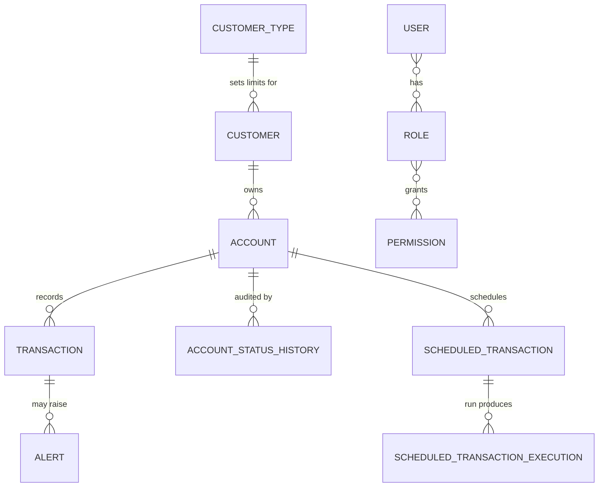

# Bank API

A banking backend built with Spring Boot 3 and Java 21: customers, accounts, money movement, scheduled transfers and reporting.

The interesting part of this project is not the CRUD — it is what happens when two people move money at the same time. Transfers take row locks in a fixed order to avoid deadlocks, writes are idempotent so a retried request cannot debit an account twice, and money is handled with `BigDecimal` at a fixed scale throughout.

[](https://openjdk.org/projects/jdk/21/)
[](https://spring.io/projects/spring-boot)
[](LICENSE)

---

## 1. Project Overview

**What it does.** A REST API for a retail bank. Customers register, open accounts, deposit, withdraw and transfer money, browse their transaction history, and schedule recurring transfers. Administrators manage customers and pull aggregated financial reports as PDF or Excel.

**Why I built it.** I wanted a project where correctness actually matters. In most CRUD portfolio apps a race condition is invisible; in a banking ledger it is money that disappears. That constraint forced me to learn things I would otherwise have skipped — transaction isolation, pessimistic locking, deadlock ordering, idempotency, and how easily `double` corrupts a balance.

**Main technologies.** Spring Boot 3.3, Spring Security with JWT, Spring Data JPA over MySQL, Redis for caching, Docker Compose for local infrastructure, and JUnit 5 + Testcontainers for tests.

---

## 2. Features

### 🔐 Authentication & Authorization
- Stateless JWT authentication, with separate login endpoints for customers and administrators.
- Refresh tokens, plus logout that invalidates a token by persisting its ID until it expires.
- Two-level access control: coarse roles (`CUSTOMER`, `ADMIN`) and fine-grained permissions attached to roles.
- Ownership checks — a customer can only reach their own accounts, enforced in the security layer rather than scattered through services.

### 👤 Customer Management
- Self-service registration, profile read/update, and password change.
- Admin endpoints for listing, fetching, updating and deleting customers, and for changing a customer's type.
- Customer types (`INDIVIDUAL`, `BUSINESS`) carry different per-transaction limits, seeded from configuration at startup.

### 🏦 Account Management
- Open, fetch, list and close accounts; generated account numbers.
- Account lifecycle status (`ACTIVE`, `FROZEN`, `CLOSED`) with a full status-history audit trail.
- `GET /api/accounts/myAccounts` returns the caller's own accounts.

### 💸 Transactions
- Deposit, withdraw and transfer, with a configurable percentage fee.
- Transfers lock both accounts in a deterministic order, so concurrent opposite-direction transfers cannot deadlock.
- Idempotency keys: a retried request with the same key returns the original result instead of moving money twice, and the same key sent with a *different* payload is rejected.
- Filterable, paginated transaction history (amount range, type, date range, sort).
- Scheduled transfers executed by a background job, each run recorded.
- Velocity-based fraud detection that raises an alert when an account exceeds 5 transactions in 10 seconds.

### 📊 Reports
- Weekly, quarterly and yearly aggregates (min / max / average amount).
- Financial reports exported as **PDF** (OpenPDF) and **Excel** (Apache POI), with charts via JFreeChart.
- Statistics endpoints for account transactions by balance and customers by city.

### 🛡️ Security
BCrypt password hashing, method-level authorization, token invalidation on logout, and a global exception handler that returns consistent error codes without leaking stack traces. See [Security](#8-security).

### ✅ Validation
Bean Validation on incoming DTOs plus custom validators, with field-level errors returned in a predictable envelope.

### ⚡ Caching
Redis-backed caching for account lists, transaction history and report aggregates. History uses a **version-key** strategy rather than eviction — see [Architecture](#3-architecture).

### 🧪 Testing
Unit tests with Mockito, JPA slice tests, and a Testcontainers MySQL harness for integration testing. Coverage is measured with JaCoCo and is currently low — the honest numbers are in [Testing](#9-testing).

---

## 3. Architecture

A conventional layered design. The rule I held to is that each layer only speaks to the one below it, and entities never leave the service layer.

```mermaid
flowchart TD
    Client([Client])

    subgraph Web["Web layer"]
        Controller["Controllers<br/>HTTP, DTOs in/out"]
        Advice["GlobalExceptionHandler<br/>error envelope"]
    end

    subgraph Domain["Service layer"]
        Service["Services<br/>business rules, @Transactional"]
        Security["Security beans<br/>ownership checks"]
        Events["Domain events<br/>published AFTER_COMMIT"]
    end

    subgraph Data["Persistence layer"]
        Repo["Spring Data repositories"]
        Entity["JPA entities"]
    end

    MySQL[("MySQL")]
    Redis[("Redis")]
    Scheduler["@Scheduled job"]

    Client -->|JSON + Bearer token| Controller
    Controller -->|DTO| Service
    Controller -.->|throws| Advice
    Service --> Security
    Service --> Repo
    Service <-->|@Cacheable| Redis
    Repo --> Entity
    Entity --> MySQL
    Service --> Events
    Events -->|alerts, cache invalidation| Service
    Scheduler --> Service
```

### Layers

**Controller → Service → Repository.** Controllers do HTTP only: bind the request, validate it, delegate, return a DTO. All business rules live in services. Repositories are Spring Data interfaces, with JPA Specifications for the dynamic transaction-history filters and native queries for report aggregates.

`TransactionFacade` sits in front of the transaction services as a single entry point that applies authorization and caching, so controllers do not have to know which of several collaborators handles a given operation.

### DTOs

Entities are never serialized to the client. Requests and responses are separate DTO types, mostly Java `record`s. This matters for more than tidiness: returning a JPA entity from a controller invites lazy-loading exceptions outside the transaction, and quietly exposes every field you later add to the table.

### Entity relationships



A transfer writes **two** transaction rows — a `TRANSFER_OUT` against the source and a `TRANSFER_IN` against the destination — so each account's history reads correctly on its own and the ledger stays double-entry.

Shared columns (`createdAt`, `updatedAt`) come from an `Auditable` base class populated by JPA auditing.

### MapStruct

Entity ⇄ DTO mapping is generated at compile time by MapStruct rather than written by hand or done reflectively. Compile-time generation means a renamed field becomes a **build error** instead of a silently null response field, and there is no reflection cost per request.

### Spring Security

Configured as an OAuth2 **resource server** with a custom `JwtDecoder`, rather than a hand-rolled `OncePerRequestFilter`. Spring's filter chain then handles token parsing, error responses and the security context, and authorities are mapped straight from a claim. `@EnableMethodSecurity` turns on `@PreAuthorize` at the service layer.

### Exception handling

A single `@RestControllerAdvice` maps domain exceptions to HTTP status codes via an `ErrorCode` enum, so every error response has the same shape and clients can branch on a stable code rather than parsing prose.

### Validation

Bean Validation runs at the controller boundary; rules that need database or contextual state (transaction limits, account status) are enforced in services, because a validator annotation cannot see the account it is validating against.

### Transaction management

Services are `@Transactional`, with `open-in-view` disabled so no lazy loading can leak into view rendering. Money movement uses `PESSIMISTIC_WRITE` row locks. Idempotency status writes use `REQUIRES_NEW` so the record of an attempt survives even when the business transaction rolls back.

### Caching

Redis, via `@Cacheable`. Two decisions worth explaining:

- **Version keys instead of eviction.** Transaction history is cached under a key containing a per-account version counter. Writing a transaction bumps the counter, which makes every previously cached page for that account unreachable in one operation — no scanning for keys to evict, and no risk of missing one.
- **Typed serializers per cache.** Each cache declares the exact type it stores. A single generic serializer has to embed Java class names in the stored JSON and still cannot round-trip the element type of a `List<T>`. Declaring the type keeps stored values plain, inspectable JSON.

### Scheduling

A `@Scheduled` job polls every 30 seconds for due scheduled transfers and executes them, recording each run. It is disabled under the `test` profile so it cannot interfere with tests.

> **Honest limitation:** this scheduler assumes a single running instance. Deploy two and both will pick up the same due transfer. Fixing it needs a shared lock (ShedLock) or a real job scheduler — see [Future Improvements](#10-future-improvements).

---

## 4. Tech Stack

| Technology | Version | Why it's here |
|---|---|---|
| **Java** | 21 | Records for DTOs, sealed/pattern matching, and virtual threads (enabled) to handle blocking JDBC calls without a large thread pool. |
| **Spring Boot** | 3.3.4 | Removes the configuration boilerplate and gives one consistent way to wire, configure and test the app. |
| **Spring Security** | 6.x | Authentication and authorization. Used as a resource server so token handling is framework code, not mine. |
| **Spring Data JPA** | 3.x | Derived queries and Specifications remove most DAO boilerplate; I drop to native SQL where aggregation is clearer. |
| **Hibernate** | 6.x | JPA provider. Also gives explicit lock modes, which the transfer logic depends on. |
| **MySQL** | 8.4 | Transactional relational store. Money needs ACID and foreign keys; row-level locking is what makes safe transfers possible. |
| **Redis** | 7.4 | Cache for read-heavy endpoints. Chosen over an in-process cache so the cache survives restarts and stays correct if the app is scaled to more than one instance. |
| **Docker / Compose** | — | One command brings up MySQL, Redis and the app, so the project runs the same on any machine. |
| **Testcontainers** | 1.21 | Runs integration tests against a real MySQL container. An in-memory database would not reproduce MySQL's locking behaviour, which is the thing most worth testing here. |
| **JWT (Nimbus JOSE)** | — | Stateless auth; no server-side session store. Signed with HS512. |
| **Maven** | 3.9 (wrapper) | Build and dependency management. The wrapper means no local Maven install is required. |
| **MapStruct** | 1.5.5 | Compile-time entity ⇄ DTO mapping — mismatches fail the build instead of at runtime. |
| **JUnit 5** | 5.x | Test framework. |
| **Mockito** | 5.x | Isolating a service from its collaborators in unit tests, with strict stubs to catch dead setup. |
| **JaCoCo** | 0.8.13 | Coverage measurement, so the gaps are visible rather than assumed. |
| **springdoc / OpenAPI** | 2.6.0 | Generates the API description and Swagger UI from the actual controllers, so docs cannot drift from code. |
| **Apache POI / OpenPDF / JFreeChart** | — | Excel, PDF and chart generation for financial reports. |
| **Lombok** | 1.18.38 | Cuts constructor/accessor boilerplate. |
| **Spotless** | 2.43 | Enforces google-java-format so formatting never appears in a diff. |

---

## 5. Project Structure

```
src/main/java/com/example/bankspringboot/
├── config/          Spring configuration: security, JWT decoding, Redis caching,
│                    OpenAPI, Jackson, startup seeding, typed @ConfigurationProperties
├── controller/      REST endpoints. HTTP concerns only
├── service/         Business rules and transaction boundaries
│   └── specifications/  JPA Specifications for dynamic queries
├── repository/      Spring Data repositories
├── domain/          JPA entities and enums, grouped by aggregate
│   ├── account/  customer/  transaction/  scheduledtransaction/
│   ├── alert/  idempotency/  admin/  common/
├── dto/             Request/response types, grouped by feature
├── mapper/          MapStruct mapper interfaces
├── security/        Ownership checks used from @PreAuthorize
├── events/          Domain events
├── listeners/       AFTER_COMMIT handlers: fraud alerts, cache invalidation
├── scheduler/       Scheduled transfer job
├── exporters/       PDF and Excel report writers
├── exceptions/      AppException, ErrorCode, GlobalExceptionHandler
├── validation/      Custom Bean Validation constraints
├── cache/           Cache version-key holder
└── common/          Shared enums and constants
```

**Why events.** Fraud detection and cache invalidation are published as domain events handled `AFTER_COMMIT`. A fraud alert should not be raised for a transfer that then rolls back, and a cache should never be invalidated for a write that never landed. Ordering the work after commit makes both correct by construction, and keeps that logic out of the transfer path.

---

## 6. Running the Project

### Prerequisites

| | Required for |
|---|---|
| **JDK 21+** | Building and running |
| **Docker + Docker Compose** | MySQL, Redis, and the integration tests |
| **Maven** | Not needed — use the bundled `./mvnw` wrapper |

### 1. Clone

```bash
git clone https://github.com/zzkhangg/bank-spring-boot.git
cd bank-spring-boot
```

### 2. Configure environment variables

```bash
cp .env.example .env
```

Then edit `.env`. One value needs real attention:

```bash
# HS512 requires a Base64-encoded key of at least 512 bits.
# A short passphrase will fail at startup — generate a proper one:
openssl rand -base64 64
```

`.env` is git-ignored. `.env.example` documents every variable the app reads.

### 3. Run everything with Docker

```bash
docker compose up --build
```

This starts MySQL, Redis and the API. The app waits for both datastores to report healthy before booting. The API is on `http://localhost:8080`.

### 4. Or run locally against Dockerised infrastructure

Start just the datastores, then run the app from your machine with the `dev` profile:

```bash
docker compose up -d mysql redis
./mvnw spring-boot:run -Dspring-boot.run.profiles=dev
```

The `dev` profile uses `ddl-auto: update` and seeds roles, permissions, customer types and an admin user on first boot.

### 5. Run the tests

```bash
./mvnw test                      # unit + slice tests
./mvnw verify                    # everything, including Testcontainers integration tests
./mvnw test -Dtest=TransactionExecutorTest   # a single class
```

Container-based tests skip automatically when Docker is unavailable, so the suite stays green on machines without it.

Coverage report after any test run: `target/site/jacoco/index.html`.

---

## 7. API Documentation

With the app running, the interactive documentation is generated from the controllers themselves:

- **Swagger UI** — <http://localhost:8080/swagger-ui.html>
- **OpenAPI JSON** — <http://localhost:8080/v3/api-docs>

Both are public so the API can be explored without a token; the endpoints they describe still require one.

**To call a protected endpoint from the UI:** call `POST /api/auth/customer/login`, copy the `accessToken` from the response, click **Authorize**, and paste it. Every subsequent request from the UI carries the bearer token.

### Swagger UI


### Login


> Screenshots are placeholders — save the images to `docs/` to populate them.

### Main endpoint groups

| Prefix | Purpose |
|---|---|
| `/api/auth` | Customer/admin login, refresh, logout |
| `/api/customers` | Registration and self-service profile |
| `/admin/customers` | Administrative customer management |
| `/api/accounts` | Account lifecycle and status history |
| `/api/accounts/{id}` | Deposit, withdraw, transfer, history, scheduled transfers |
| `/api/reports/financial` | PDF / Excel financial reports |
| `/api/transaction-report` | Weekly, quarterly, yearly aggregates |
| `/api/statistics` | Ad-hoc statistics |

---

## 8. Security

**JWT authentication.** Tokens are signed with HS512 and validated by a custom `JwtDecoder` registered with Spring's OAuth2 resource server. Authentication is stateless — there is no session store to replicate. Logout works by persisting the invalidated token's ID until its natural expiry, which is the trade-off stateless tokens force: you either accept that a token is valid until it expires, or you keep a small denylist. I chose the denylist.

**Role-based access control.** Two layers. Roles (`CUSTOMER`, `ADMIN`) answer "what kind of user is this", and permissions attached to roles answer "what may they do". Both are seeded at startup and mapped into the security context from token claims.

**Method security.** `@PreAuthorize` guards service methods rather than URL patterns alone. URL rules are easy to bypass by adding a new controller path; a rule on the method travels with the code that actually does the work. Ownership checks live in dedicated beans (`@accountSecurity.isOwner(...)`) so the expressions stay readable and testable.

**Password hashing.** BCrypt, via Spring Security's `PasswordEncoder`. Adaptive and salted per password.

**Idempotency.** Money-moving endpoints accept an idempotency key. The key is stored with a hash of the request body: replaying the same key with the same body returns the original response, while the same key with a *different* body is rejected as a conflict rather than silently treated as a duplicate. Status transitions are written in a `REQUIRES_NEW` transaction so the attempt is recorded even if the business transaction rolls back.

**Pessimistic locking.** Transfers take `PESSIMISTIC_WRITE` locks on both accounts. Crucially, the locks are acquired in **ascending account-ID order**, never in "source then destination" order. Two simultaneous opposite-direction transfers between the same accounts would otherwise each hold the lock the other needs — a textbook deadlock. Ordering the acquisition makes it impossible. This is unit-tested in both directions.

**Validation.** Bean Validation at the boundary, business-rule checks in services.

**Global exception handling.** One `@RestControllerAdvice` produces a consistent error envelope with a stable `ErrorCode`, and never returns stack traces or internal messages to clients.

### Known security gaps

Being straightforward about what is *not* done:

- **No rate limiting.** Login is brute-forceable.
- **Secrets in `.env` files.** Fine for local development, not for production — that belongs in a secrets manager.
- **No refresh-token rotation.** A leaked refresh token stays usable until it expires.
- **The invalidated-token table is never pruned**, so it grows without bound.

---

## 9. Testing

```bash
./mvnw verify
```

**Unit tests.** JUnit 5 with Mockito under strict stubbing, which fails a test that sets up a stub it never uses — this catches setup drifting out of sync with the code. `TransactionExecutorTest` is the most developed suite: it covers the transfer happy path, the double-entry pair written to the ledger, every rejection path (insufficient funds, self-transfer, inactive source or destination, unknown destination, over-limit), and fee arithmetic.

Two of those tests deserve a mention. Using `InOrder`, they assert that the **lower account ID is locked first regardless of transfer direction** — the reverse-direction case is the one that actually proves the deadlock avoidance rather than just exercising it. Account IDs in that suite are fixed and ordered rather than random, because locking in ID order means random IDs would change which stub is consumed first from run to run and make the suite intermittently fail.

**Integration tests.** `@SpringBootTest` verifies the full application context starts, and `@DataJpaTest` slices cover repository queries.

**Testcontainers.** `BaseIntegrationTest` provides a **MySQL 8** container wired in through `@ServiceConnection`, marked `disabledWithoutDocker = true` so the suite still passes on a machine without Docker instead of erroring. The reason for a real container is that H2 does not reproduce MySQL's row-locking semantics — testing the transfer locking against H2 would prove nothing about production.

> **Honest status:** that base class is in place but **no test extends it yet**, so repository tests currently run on H2 and the locking behaviour is only verified at the unit level. Porting the repository tests onto the container, and adding a genuine concurrent-transfer test, is the next task.

**JaCoCo coverage.** Report at `target/site/jacoco/index.html`.

| Metric | Coverage |
|---|---|
| Lines | ~24% |
| Branches | ~12% |
| Methods | ~29% |

**This is low, and I would rather show the number than hide it.** Testing was targeted at the code where a bug costs money — the transfer path is well covered, and writing those tests already found a real fee-rounding defect (the fee was computed without a rounding mode, so the persisted ledger value and the deducted balance disagreed by fractions of a cent on every transfer). Controllers, reporting and the admin surface are largely untested. Raising this is the single most valuable next piece of work on the project.

---

## 10. Future Improvements

Roughly in the order I would tackle them.

- **Database migrations (Flyway).** The schema is currently managed by Hibernate `ddl-auto`. That is fine for development and unacceptable for production, where schema changes need to be versioned, reviewed and reversible. This is the biggest gap.
- **Raise test coverage**, starting with authorization tests over the controller layer — the place where an ownership-check mistake becomes a data breach.
- **Rate limiting** on authentication endpoints.
- **Refresh-token rotation**, issuing a new refresh token on each use and detecting replay of a consumed one.
- **Distributed scheduler locking** (ShedLock) so the scheduled-transfer job is safe to run on more than one instance.
- **Audit logging** of security-relevant events: logins, permission changes, administrative actions.
- **Observability** — Micrometer metrics scraped by Prometheus and dashboarded in Grafana, plus structured logs with correlation IDs.
- **Email verification and password reset.**
- **CI/CD** — GitHub Actions running build, tests and coverage on every push.
- **Kubernetes deployment** with health probes and externalised configuration.
- **Round the withdrawal fee.** The transfer path now rounds correctly; `executeWithdrawal` still computes its fee without a scale, and carries the same defect.

---

## 11. What I Learned

The lesson that stuck was that **concurrency bugs do not show up in a demo.** Every endpoint worked perfectly when I clicked through it by hand. It was only when I reasoned about two transfers running at the same instant that I found the deadlock, and only when I wrote a test for the fee that I found the balance and the ledger disagreeing by fractions of a cent. Neither would have surfaced from manual testing, and both would have been real money.

I also learned to be deliberate about **where a rule lives**. Early on, ownership checks were scattered through controllers and services, and every new endpoint was a chance to forget one. Moving them into dedicated security beans invoked from `@PreAuthorize` made them consistent and testable in one place.

Working with `BigDecimal` taught me that money arithmetic is not obvious: scale and rounding mode have to be decided explicitly at the point of calculation, because the database will silently round on write and the two values then drift apart.

Finally, migrating the cache from an in-process store to Redis was a useful lesson in the difference between an object and a *serialized* object. Code that worked fine caching by reference broke the moment values had to survive a round trip — one cached type was a Spring Data interface projection, which is a runtime proxy that cannot be rebuilt from JSON at all. Making things serializable forces you to be precise about what your types actually are.

---

## 12. License

Released under the [MIT License](LICENSE).
